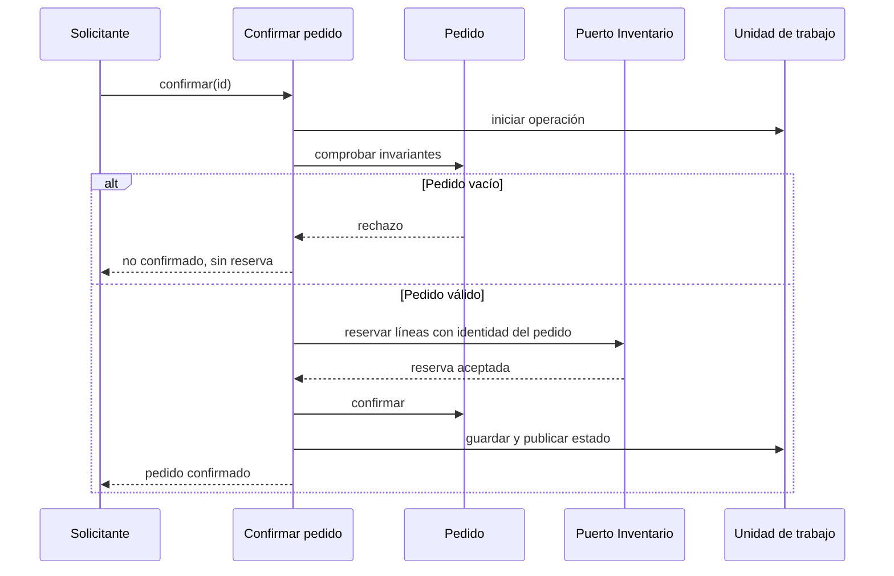

# ADR-001 · Confirmar pedidos con reserva de inventario

Estado: decisión didáctica revisable; implementación y pruebas locales, sin servicio distribuido.

## Contexto

Pedidos habla de pedido, línea y confirmación. Inventario habla de SKU, unidades disponibles y reserva. La regla «no confirmar un pedido vacío» pertenece al agregado Order, antes de solicitar inventario. Un pedido confirmado no admite nuevas líneas.

## Decisión

El caso de uso confirmOrder depende de un puerto de unidad de trabajo y de un puerto de reserva. El adaptador traduce productId/cantidad a SKU/unidades; los dominios no importan HTTP, ORM ni el agregado del otro contexto. El adaptador en memoria publica el nuevo estado solo si termina la operación completa y serializa operaciones concurrentes.

## Consecuencias y límites

La repetición no descuenta unidades dos veces. Un rechazo conserva pedido y existencias. Las pruebas ejecutadas verifican el adaptador en memoria y las reglas; no acreditan aislamiento SQL, comunicación HTTP ni transacciones entre servicios independientes. Si se separaran los contextos en servicios, habría que definir reservas durables, compensación, idempotencia y mensajería: esa es otra decisión, no una propiedad obtenida al crear carpetas.
